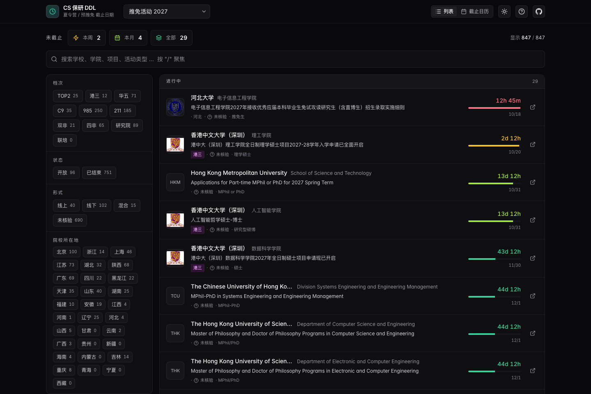
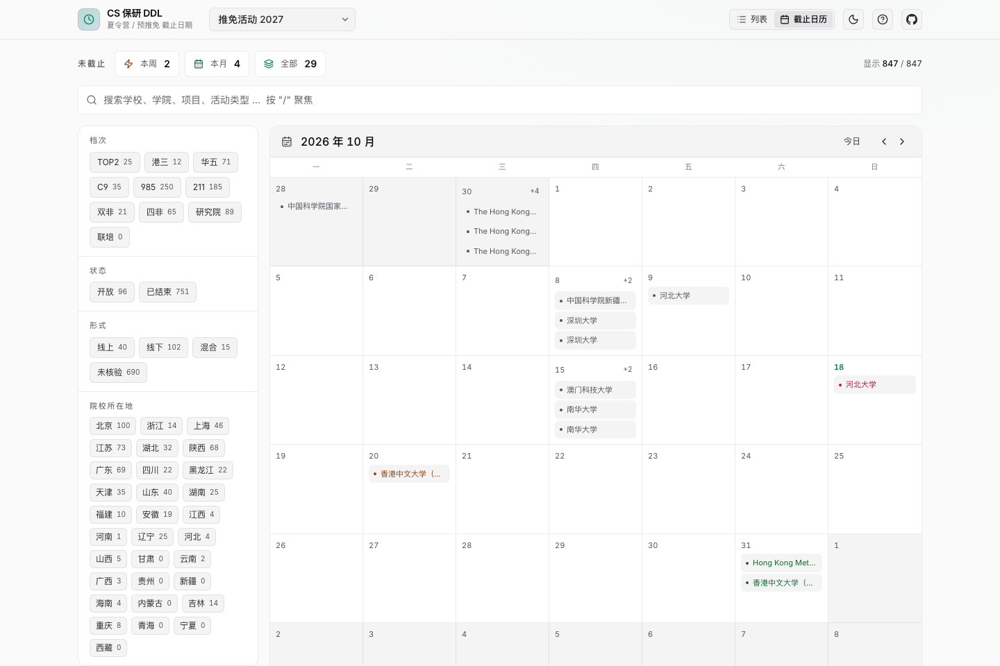
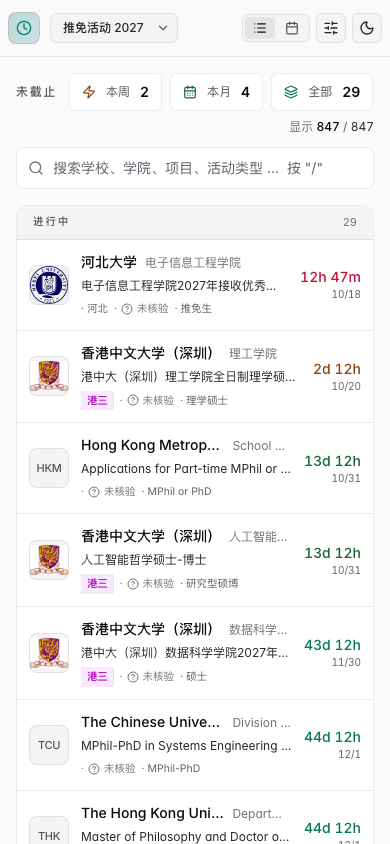
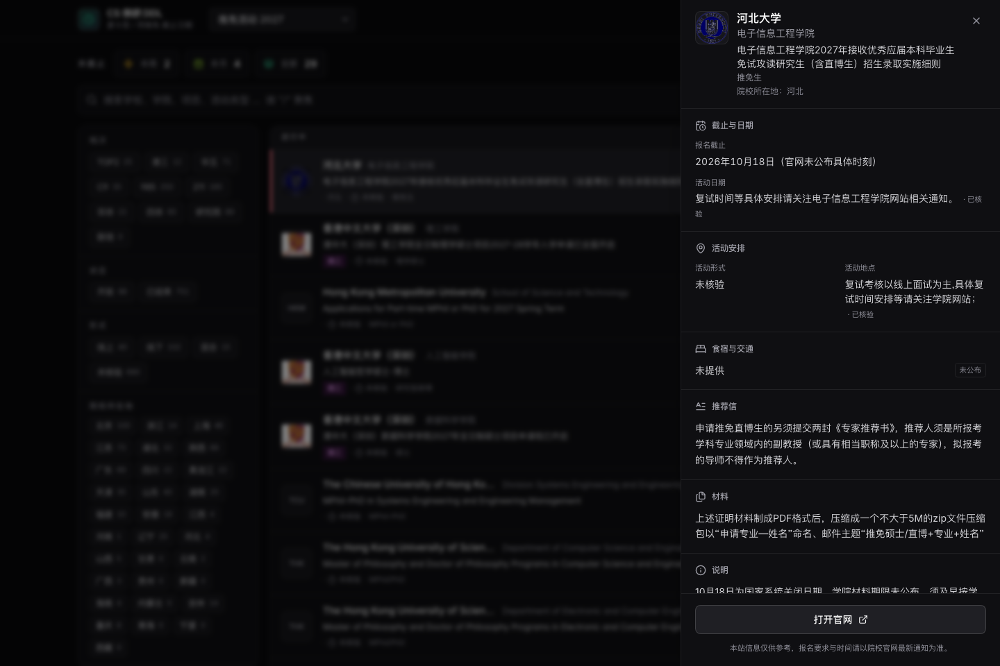
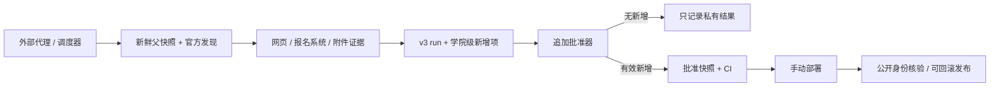

<div align="center">

# CS 保研 DDL

**把招生通知变成清晰的截止日期界面，把信息更新变成有证据的工作流。**

Svelte 5 · TypeScript · Vite 6 · Tailwind CSS 4

[](ARCHIVE.md)
[](LICENSE)
[](https://github.com/lvzaixian/CS-BAOYAN-DDL/actions/workflows/ci.yml)

[网站设计](docs/website-design.md) · [自动化工作流](docs/automation.md) · [快速复用](docs/reuse.md) · [文档导航](docs/README.md)

</div>



> **归档于 2026-10-18。** 网站、更新工具和历史数据保留，欢迎 Fork 和提出 Issue；定时更新与自动生产部署已停止。本仓库是实现与设计的展示，不承诺继续维护实时招生信息。申请时请以当年的官方通知为准。

## 两部分，一个完整项目

| | 网站设计 | 自动化更新工作流 |
| --- | --- | --- |
| 解决的问题 | 从大量项目中找到适合自己、尚可行动的截止日期 | 将零散通知转为可验证、可追加、可发布的数据 |
| 核心能力 | 列表 / 截止日历、组合筛选、搜索、详情面板、倒计时、主题、移动端 | 官方证据、学院级身份、去重、父快照守恒、原子批准、CI、发布校验与回滚 |
| 实现位置 | `src/`、`public/` | `scripts/`、`data/`、`deploy/`、`.github/` |
| 如何复用 | 克隆后直接启动，无需后端或密钥 | 接入自己的可信采集代理，按 v3 契约交付证据与新增项 |

前端是**构建时加载 JSON 的静态网站**。数据处理在离线 TypeScript 脚本中完成，生产可由 Nginx 提供静态文件；没有需要单独启动的数据库或 API 后端。

## 界面预览

| 截止日历 | 移动端 |
| --- | --- |
|  |  |

截图来自本地运行的实际页面与冻结数据，没有替换为演示院校；只是归档时的界面示例。

<details>
<summary>查看项目详情面板</summary>



</details>

- 学校、学院、项目与活动类型即时搜索；按学校档次、状态、地区和活动形式组合筛选。
- 列表与截止日历共享同一份筛选状态；密集日期可展开完整项目。
- 详情侧栏集中呈现官方链接、活动安排、材料、推荐信与食宿交通信息，并区分未知或未核验字段。
- 深浅主题、移动端筛选抽屉、键盘操作与 URL 状态同步。
- 所有倒计时共享一个 1 Hz 时钟；截止后的显示状态由时间派生，历史记录持续保留。

## 五分钟运行

使用 Node.js 20 或更高版本，仓库 CI 使用 Node.js 20；pnpm 固定为 **10.28.2**。

```bash
git clone https://github.com/lvzaixian/CS-BAOYAN-DDL.git
cd CS-BAOYAN-DDL
corepack enable
corepack pnpm@10.28.2 install --frozen-lockfile
corepack pnpm@10.28.2 run dev
```

打开终端显示的地址，默认是 `http://localhost:5180`。无需 `.env`、云账户或生产凭据。

```bash
corepack pnpm@10.28.2 run build    # 输出 dist/
corepack pnpm@10.28.2 run preview  # 默认 http://localhost:4173
```

构建钩子从院校注册表生成 logo 映射，不会运行招生扫描。静态托管可以使用 `dist/`；根域名部署可直接复用，GitHub Pages 等子路径部署需调整 Vite base 与根相对资源地址，见[复用指南](docs/reuse.md)。

## 自动化如何工作



批准器保证已有项目的字段和值不被日常追加改写，拒绝缺证、身份冲突、哈希漂移及私有来源泄漏。失败时保留上一份快照。**仓库包含验证与发布工具；采集代理、联网浏览、附件解析及其调度环境由复用者提供。**

[自动化指南](docs/automation.md)提供可移植的代理执行说明、文件契约和命令；[详细契约](docs/operations/data-refresh.md)解释 v3 输入与证据规则。旧 reducer / pending 工具仍用于历史重放，日常入口是 `snapshot:approve-additive`。

## 项目结构

```text
src/                      网站、组件、视觉样式与交互状态
data/approved/            批准的公开快照
scripts/source/           院校注册表与重点哨兵
scripts/snapshot/         追加批准与历史维护工具
deploy/                   Nginx、原子激活、回滚、smoke
.github/workflows/        CI、手动部署、手动监控
tests/ · e2e/             数据契约与浏览器测试
docs/                     网站设计、自动化、复用、运维与历史资料
```

## 验证

```bash
corepack pnpm@10.28.2 run snapshot:validate
corepack pnpm@10.28.2 run test:unit
corepack pnpm@10.28.2 run check
corepack pnpm@10.28.2 run build
corepack pnpm@10.28.2 run check:public
corepack pnpm@10.28.2 exec playwright install chromium
corepack pnpm@10.28.2 run test:e2e
```

浏览器测试使用独立的合成 fixture、固定时间与隔离构建，覆盖桌面、移动端和窄屏；不会改写生产快照。CI 的必需检查名为 `verify`。部署与监控默认手动运行，Fork 后需按自己的环境配置再使用。

## 数据与归档

- 冻结批准快照包含 **847 条记录**，批准于 **2026-09-19**；这个数字是历史快照规模，不表示今天仍然开放的项目数。
- 旧分支中的修复已逐项对照当前 main；重复实现和过时快照不覆盖当前数据。历史分支、额外旧数据和整合取舍见[归档说明](ARCHIVE.md)。
- 原始抓取、个人申请状态、私有运行记录和凭据不属于公开项目。公开仓库保留可复用的代码、契约和已批准数据。
- 归档后不承诺实时更新或全国覆盖；发现错误可提交带官方来源的 Issue，复用者可继续自己的周期。

## 来源与许可

界面基于 [CS-BAOYAN/CS-BAOYAN-DDL](https://github.com/CS-BAOYAN/CS-BAOYAN-DDL)，保留 [MIT 许可证](LICENSE)与原版权声明。历史线索来自 CS-BAOYAN、BoardCaster 等社区；公开新增事实以院校官网、官方报名系统、官方公众号或官方附件为依据，聚合内容只帮助发现线索。

MIT 适用于本仓库代码；院校名称、标识和外链资料的权利归原权利人。复用时请保留上游署名，并自行核对信息时效与数据使用边界。
