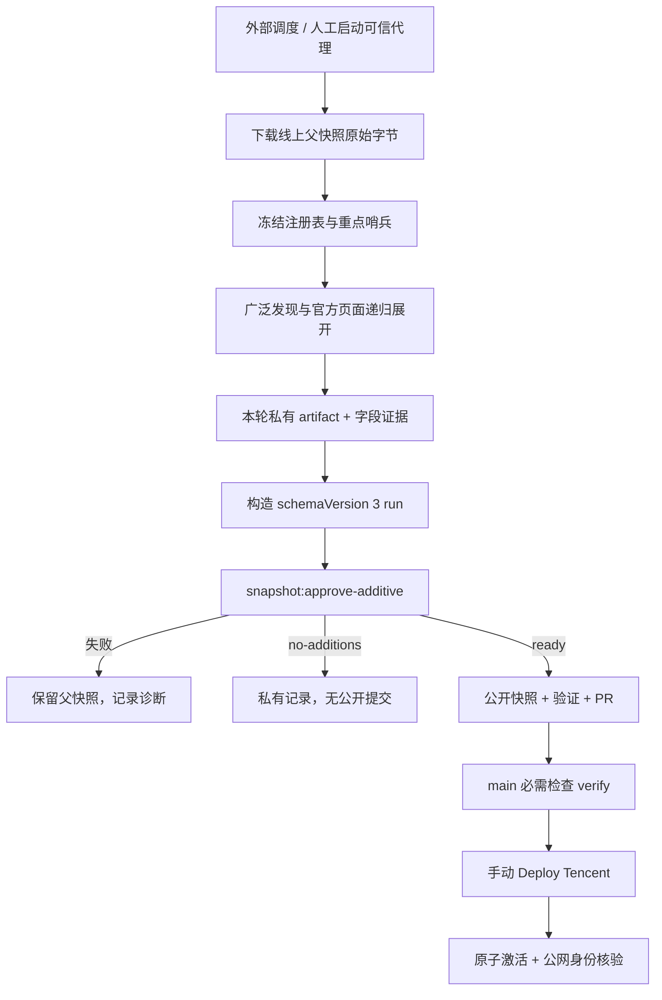

# 自动化更新工作流

这部分可以独立于界面复用：将可信采集代理产生的官方证据与新增项，变成通过检查的公开快照。**采集执行器由使用者提供，本仓库提供数据契约、批准器、校验、CI 和部署工具。**

归档后没有定时运行；需要继续运营时，在自己的环境里接入代理和调度器。原作者本机的私有任务、申请资料或 Codex 配置不是运行依赖。

## 一条主链路



### 1. 发现与抽取由代理负责

- 输入：院校注册表、重点哨兵、聚合线索、官方页面与报名系统。
- 先广后深：发现学院/研究院，再展开具体公告、系统、PDF、Office 附件与图片；图片或扫描页需要真实 OCR / 可读检查。
- 官网、官方系统、官方公众号及官方附件支撑事实；社区汇总只帮助发现。
- 每次运行都使用新目录、真实抓取时间和原始文件，不能把旧候选刷新时间后当成本轮证据。

这里没有内置浏览器爬虫、OCR 服务、LLM API 客户端或“运行一个命令就全网更新”的调度器。可以使用自己的浏览代理、脚本或人工采集，只要其输出满足同一契约。

### 2. 批准器负责确定性检查

日常入口：[`approve-additive-snapshot.ts`](../scripts/snapshot/approve-additive-snapshot.ts)。核心类型与实现位于 [`approve-snapshot.ts`](../scripts/snapshot/approve-snapshot.ts)。

| 检查 | 保护的约束 |
| --- | --- |
| 父本 | 下载原始字节的 SHA-256、snapshotId、dataHash 与当前批准文件一致 |
| 本轮范围 | 注册表/哨兵原始哈希、北京时间轮转日期、确定的必查 scope |
| 固定发现检查 | 深研派个人页、当年夏令营合集、当年预推免合集三项均记录 checked 或有原因的 blocked |
| 官方证据 | 真实普通文件、重读字节、SHA-256、同校同 URL 和字段引文绑定 |
| 新增身份 | 学院级四段 projectId；与父本及同轮新增去重 |
| 公开边界 | 不带私有发现 provenance、申请状态、个人信息或凭据 |
| 追加性 | 保留父项完整字段和值；新增为零不写公开文件 |
| 写入 | 锁、原子替换、失败关闭；无效输入不改旧快照 |

这些检查验证输入与规则的一致性，不替采集代理判断所有网页语义，也不能证明没有遗漏未来通知。

### 3. 展示与发布分开

前端构建读取批准快照。已保存的历史项目不会因今天过期而被删除；展示状态由截止时间派生。重新构建会继续使用相同历史数据，不会触发扫描。

CI 验证 PR 与 main。归档版本的部署和监控都仅支持手动触发，恢复运营者可以审阅后自行配置调度。部署时生成静态 `/data/current.json` 和 `/data/release.json`，核对 `{releaseSha, snapshotId, dataHash, archiveSha}`，原子切换并保留回滚能力。

## 最小交接目录

下面是文件布局，文件名可自定；其内容必须真实生成，不能把目录图当作可执行样例。

```text
private-run/
  public-parent.json       新下载的线上原始字节
  additive-run.json        schemaVersion: 3 的本轮输入
  artifacts/               原始官方页面、附件与提取文本
  release-decision.json    批准器输出；不提前伪造
```

`additive-run.json` 包含：

- `schemaVersion: 3`，唯一 `runId`，`incremental` / `sweep`，本轮起止时间；
- `parent`：公开 URL、原始字节 SHA-256、snapshotId、dataHash、`privateParentCandidateUsed: false`；
- `coverage`：schemaVersion、北京时间 rotationDate、注册表与哨兵文件 SHA-256；
- `fixedDiscoveryChecks`：三项固定发现记录；
- `scopes`：实际尝试的学校/学院发现树、结果、时间、artifact 绑定和受阻原因；
- `artifacts`：相对普通文件路径、URL、类型、时间、SHA-256、可选提取文本绑定；
- `additions`：公开 `opportunity` 与私有 `evidence`；身份、状态、截止、安排、材料、推荐、后勤等字段逐项绑定来源。

完整形状见[运行契约](operations/data-refresh.md)。可执行的合成案例在 [`tests/approve-additive-snapshot.test.ts`](../tests/approve-additive-snapshot.test.ts)：`additiveRun`、`evidenceFor`、`materializeRunArtifacts` 构造互相一致的 run、字段证据与真实字节；测试同时覆盖成功、无新增、缺证、身份冲突和路径攻击。它们只用于离线学习和回归，不能当作生产证据。

## 运行命令

先按[复用指南](reuse.md)安装依赖。以下命令假定采集代理已经生成真实、有效的私有输入。`RUN_DIR` 指向私有运行目录，文件不要放进公开 Git。

```bash
RUN_DIR="$(mktemp -d "${TMPDIR:-/tmp}/cs-ddl-run.XXXXXX")"
PARENT_URL='https://ddl.example.com/data/current.json'
curl --fail --show-error --silent "$PARENT_URL" -o "$RUN_DIR/public-parent.json"
```

在生成 run 前，确认线上父本是你自己的合法批准快照，且本地 `data/approved/current.json` 与下载字节一致。首次 Fork 若只有静态网站、尚无公开数据端点，应先完成一次带发布身份的初始部署；不要把预览服务器的 SPA HTML 当作父本。

把 `RUN_DIR`、`PARENT_URL`、仓库根目录、模式及注册表/哨兵交给采集代理。代理完成输入后再执行：

```bash
corepack pnpm@10.28.2 run snapshot:approve-additive -- \
  --run "$RUN_DIR/additive-run.json" \
  --parent "$RUN_DIR/public-parent.json" \
  --parent-url "$PARENT_URL" \
  --approved data/approved/current.json \
  --decision "$RUN_DIR/release-decision.json" \
  --registry scripts/source/universities.json \
  --sentinels scripts/source/priority-sentinels.json
```

`--parent-url` 是**执行者指定的预期来源**，必须与 run 中的 `parent.url` 完全一致；只接受无凭据、无 query/fragment 的 HTTPS 地址，路径以 `/data/current.json` 结束。省略时沿用原项目地址。它不负责联网下载，也不代表远端归属证明；真实抓取与哈希仍由执行器提供、批准器复核。部署/监控的 `PUBLIC_BASE_URL` 是另一项配置，不能代替这个参数。

- `no-additions`：到此结束，只保留私有结果。
- `ready`：检查 `git diff -- data/approved/current.json`，运行 README 验证集，只提交公开变更，再经 PR 的 `verify` 检查合入 main。
- 出错：保留原快照和本轮诊断，修正采集输入；不要跳过失败或将它伪装为“没有新增”。

## 可交给代理的执行说明

将下列说明连同真实的仓库目录、私有目录、预期父 URL 和运行模式交给你的执行器。它是交接协议，不绑定特定 AI 产品。

> 阅读 AGENTS.md 和 docs/operations/data-refresh.md，按当前 v3 追加契约工作。新建唯一 runId，不复用旧私有候选。下载指定公开父 URL 的原始字节并冻结哈希；冻结当前注册表、哨兵与北京时间轮转日。尝试本轮确定范围，递归展开官方学院通知、报名系统和附件，保存真实 artifact 与提取文本。完成三个固定发现检查；阻断时如实写原因。按最小适用招生单位建立新 projectId，为全部要求字段提供同轮官方证据。只把有效且父本中没有的条目放入 additions，不改写父项。构造真实 v3 run 后调用追加批准器，显式传预期父 URL。无新增只留私有记录；ready 才运行验证并提交公开快照。不要提交私有文件，不绕过验证、验证码、登录或访问限制；没有明确发布授权时止于本地验证。归档仓库本身不授权恢复调度或生产部署。

扫描器需要自行提供浏览、下载、解析 PDF/Office/OCR、重试、速率控制和私有存储；不要假定克隆代码就拥有这些外部能力。

## 历史工具与继续维护

`scan:build-release`、`pending:commit`、`snapshot:approve` 及 ScanBundle v2 保留历史重放与经授权维护用途，不能混作日常追加入口。修正、合并身份或删除旧项目，需要独立维护计划和差异验证。

要改变招生周期、范围、固定发现源或证据规则，应同步改注册表/哨兵、批准器及测试。单改提示词不能绕过实现中的规则。部署、监控和恢复操作见[文档导航](README.md)。
