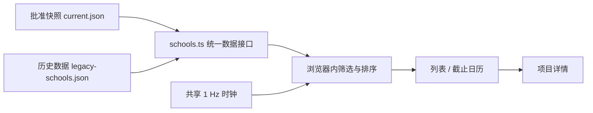

# 网站设计与实现

这个网站把“先找到可申请项目，再核对官方要求”作为主要阅读路径。列表用于快速浏览，截止日历用于安排时间，详情面板集中呈现报名与活动信息。界面与数据发布工具分开，可以单独复用网站。

> 这是归档项目的实现说明。保存的数据属于历史记录，页面中的倒计时和状态变化不代表仍在更新招生信息。项目入口见 [README](../README.md)，数据工作流见 [自动化工作流](automation.md)。

## 1. 架构：静态页面，构建时载入数据

技术栈为 **Svelte 5 runes + TypeScript + Vite 6 + Tailwind CSS 4**，图标来自 `lucide-svelte`。仓库没有独立业务后端、数据库或登录服务。

- `src/lib/schools.ts` 静态导入 `data/approved/current.json` 和 `src/data/legacy-schools.json`，生成数据源目录与统一的项目对象。旧 schema 的缺失字段通过适配层明确显示为未核验。
- `vite.config.ts` 在生产构建中把 `$approved` 指向真实快照，在 E2E 构建中指向 `e2e/fixtures`。测试样本不会成为生产数据。
- `scripts/build-logos.ts` 在开发、生产构建和 E2E 构建前，从学校注册表提取 logo 映射；排名等无关字段不会随这份映射进入页面。
- 页面不在倒计时时重新请求数据。部署链路额外生成的 `/data/current.json`、`/data/release.json` 用于公开校验和监控，不是页面的运行时 API。

## 2. 页面结构与组件

| 区域 | 源文件 | 设计与行为 |
| --- | --- | --- |
| 页面编排 | [`src/App.svelte`](../src/App.svelte) | 统一数据源、筛选结果、选中项目、抽屉、快捷键与时钟生命周期 |
| 顶部导航 | [`Header.svelte`](../src/components/Header.svelte) | 数据源切换、列表/日历切换、主题、移动筛选和键盘帮助 |
| 搜索与摘要 | [`Toolbar.svelte`](../src/components/Toolbar.svelte) | 未截止数量、当前显示数量、即时搜索与可移除筛选标签 |
| 筛选面板 | [`FilterPanel.svelte`](../src/components/FilterPanel.svelte) | 学校档次、开放状态、活动形式、院校所在地；桌面侧栏与移动抽屉复用同一组件 |
| 项目列表 | [`ListView.svelte`](../src/components/ListView.svelte)、[`SchoolRow.svelte`](../src/components/SchoolRow.svelte) | 按进行中、未知截止、已过期分组；一行突出学校、学院、项目和剩余时间 |
| 截止日历 | [`CalendarView.svelte`](../src/components/CalendarView.svelte) | 周一开始的六周月历；密集日期展开完整列表，点击后进入同一详情面板 |
| 项目详情 | [`DetailPanel.svelte`](../src/components/DetailPanel.svelte) | 截止与日期、活动形式与地点、食宿交通、推荐信、材料、补充说明和官方入口 |
| 键盘帮助 | [`KbdHints.svelte`](../src/components/KbdHints.svelte) | 可关闭的模态帮助，列出 `/`、`j/k`、方向键、`Enter`、`Esc`、`?` |

列表优先展示最早截止的开放项目；未知截止项目单独成组，避免把“未公布”误当成一个具体日期；过期项目保留并按截止时间倒序排列。日历只放入有可解析截止时间的项目，默认定位到最早开放截止所在月份，没有这类项目时回退到历史截止或当前月份。

筛选的同一维度采用 **OR**，维度之间采用 **AND**。搜索匹配学校、学院、项目和活动类型。筛选面板的计数与顶部未截止统计基于当前数据源全量项目；“显示 x / y”反映筛选结果。界面的“本周”“本月”分别表示未来 **7 天、30 天** 的滚动窗口。

## 3. 视觉系统

颜色的唯一入口是 [`src/app.css`](../src/app.css)。深色值在 `@theme` 中定义，浅色由 `:root:not(.dark)` 覆盖；主题通过 `<html class="dark">` 切换。

| 用途 / token | 浅色 | 深色 |
| --- | --- | --- |
| 页面 `surface-0` | `#fafafa` | `#09090b` |
| 面板 `surface-1` | `#ffffff` | `#0f0f12` |
| 悬停 `surface-2` | `#f4f4f5` | `#16161a` |
| 选中 / 标签 `surface-3` | `#e4e4e7` | `#1f1f24` |
| 主文字 `fg-0` | `#09090b` | `#fafafa` |
| 正文 `fg-1` | `#27272a` | `#d4d4d8` |
| 次文字 `fg-2` | `#52525b` | `#a1a1aa` |
| 辅助文字 `fg-3` | `#71717a` | `#94949e` |
| 弱化文字 `fg-4` | `#5f5f68` | `#8b8b96` |
| 分隔线 `line` | `rgba(9, 9, 11, .08)` | `rgba(244, 244, 245, .08)` |
| 强分隔线 `line-strong` | `rgba(9, 9, 11, .16)` | `rgba(244, 244, 245, .16)` |

紧迫度由剩余时间派生，颜色与日期文字同时表达含义：

| 剩余时间 | token | 浅色 | 深色 |
| --- | --- | --- | --- |
| 小于 24 小时 | `urge-critical` | `#be123c` | `#fb7185` |
| 24 小时至不足 7 天 | `urge-soon` | `#92400e` | `#fbbf24` |
| 7 天至不足 30 天 | `urge-near` | `#166534` | `#a3e635` |
| 30 天及以上 | `urge-far` | `#047857` | `#34d399` |
| 已结束 | `urge-expired` | `#52525b` | `#8b8b96` |

正文使用 Inter 与系统中英文字体回退；等宽字体声明为 JetBrains Mono 与系统等宽回退。数字通过 `.tabular` 开启等宽数字，减少倒计时变化时的跳动。页面主文字多为 14px，说明多为 12px，分组标签约 10.5–11px。Inter 样式来自外部字体服务，学校 logo 也可能使用外部图片；字体或图片不可用时分别回退系统字体与学校简称。

布局以 Tailwind 默认间距为基础：页面内容最大 `80rem`，水平留白按断点为 `1rem / 1.5rem / 2rem`，主要区域间距 `1rem`；导航高 `3.5rem`，桌面筛选侧栏宽 `260px`。主要面板使用 `rounded-xl`，搜索和图标容器多用 `rounded-lg`，轻描边区分层级。页面背景保留低透明度翠绿与天蓝径向渐变。

## 4. 状态、时间与分享

[`src/lib/urlState.svelte.ts`](../src/lib/urlState.svelte.ts) 管理浏览器 URL 中的可分享状态：

| 参数 | 内容 | 示例 |
| --- | --- | --- |
| `src` | 数据源 ID | 使用快照中实际存在的 feed ID |
| `view` | 视图 | `calendar`，默认 `list` 时省略 |
| `q` | 搜索词 | `人工智能` |
| `tags` | 学校档次 | `985,211` |
| `status` | 展示状态 | `开放`、`已结束` |
| `modes` | 活动形式 | `online,hybrid` |
| `prov` | 院校所在地 | `北京,上海` |

搜索输入使用 `replaceState`，离散筛选和视图切换使用 `pushState`；浏览器前进、后退会还原条件。选中项目、日历月份与抽屉开关属于临时界面状态，不写入 URL。主题单独保存在 `localStorage.theme`，默认浅色。

[`clock.svelte.ts`](../src/lib/clock.svelte.ts) 为所有项目提供一个共享的每秒时钟；[`filter.ts`](../src/lib/filter.ts) 结合已保存的状态和截止时间计算显示分组。已确认开放的项目到期后自动进入已过期组，**不回写快照**。详情区保留官方原文的时间精度：官方只给日期时，不把内部规范化时刻伪装成官方公布的时刻。

日期标签与日历使用浏览器本地时区；E2E 配置固定为 `Asia/Shanghai`。复用到跨时区场景时，应先明确业务时区，再统一调整 `src/lib/time.ts` 与日历计算，并补充时区测试。

## 5. 响应式与可访问性

- `lg`（默认 1024px）以上显示 260px 筛选侧栏；更窄屏幕使用底部抽屉，最大高 `85dvh`。
- 详情在 `sm`（默认 640px）以上宽 `460px`，更窄时占满视口。详情字段在 400px 以上可分两列，长文本和 URL 允许换行。
- 桌面日历每格预览最多三个学校；移动端用日期数量按钮展开完整项目列表，避免把长校名压在狭窄格子里。
- 交互采用原生按钮、链接、搜索框和选择框。切换按钮使用 `aria-pressed`；详情、移动筛选和快捷键帮助包含模态语义、焦点约束、`Esc` 关闭与焦点归还，背景使用 `inert`。
- 全局 `:focus-visible` 提供 2px 焦点轮廓；`prefers-reduced-motion` 降低动画时长。logo 旁已有学校文字，图片采用空 `alt` 避免重复朗读。

[`e2e/ddl.spec.ts`](../e2e/ddl.spec.ts) 覆盖桌面、390px 移动端、320px 窄屏，以及筛选历史、日历展开、长文本溢出、键盘与 axe 严重问题检查。这些自动化检查有助于回归，不能替代真实设备和辅助技术体验评估。

## 6. 从哪里改起

| 复用目标 | 优先修改位置 | 需要一起核对 |
| --- | --- | --- |
| 品牌、主题与视觉 | `index.html`、`Header.svelte`、`src/app.css` | 标题、描述、图标、浅深色和外部链接 |
| 列表与详情布局 | `SchoolRow.svelte`、`DetailPanel.svelte` | 长字段、窄屏、焦点归还与官方链接 |
| 筛选维度 | `types.ts`、`filter.ts`、`urlState.svelte.ts`、`FilterPanel.svelte` | URL 解析、计数、标签清空、历史恢复与测试 |
| 数据字段 | `snapshot-types.ts`、`snapshot-validation.ts`、`schools.ts` | 批准器、完整性计算、详情展示与 E2E fixture |
| 日历与时间规则 | `CalendarView.svelte`、`time.ts`、`clock.svelte.ts` | 未知截止、到期边界、密集日期和时区 |
| 静态部署或数据发布 | `vite.config.ts`、`.github/workflows/`、`deploy/` | 根路径资源、生产与测试数据隔离、发布身份与回滚 |

继续操作见 [Fork 与复用指南](reuse.md)。
